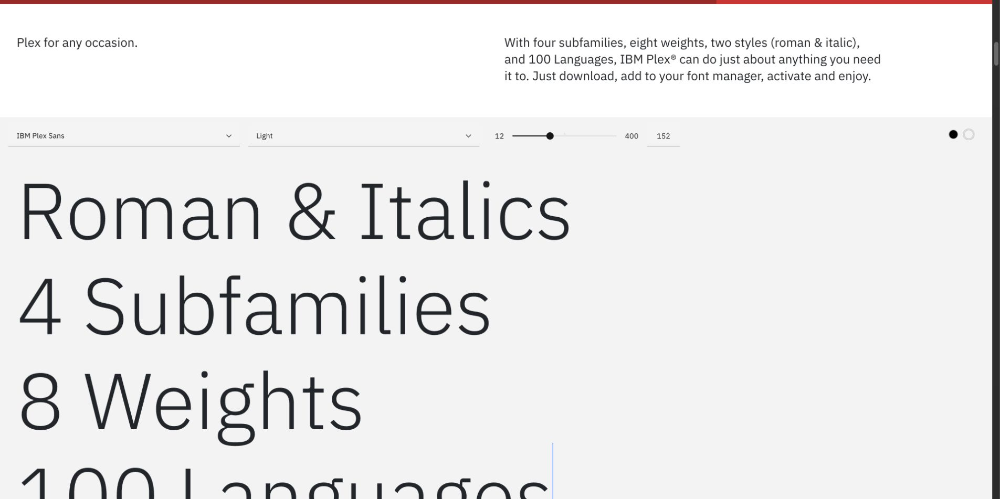
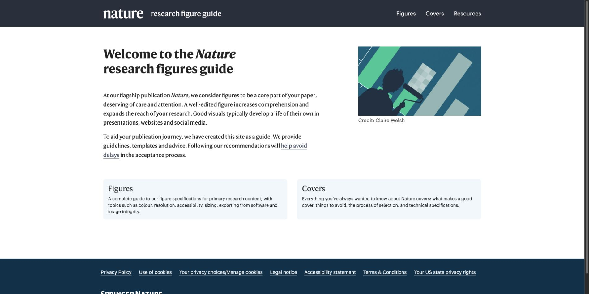

# NeuroBridge design direction

Status: Approved by the user. Phase 2 implementation is authorized. The Phase 1 observations below describe the prior UI.

## Product and audience

NeuroBridge is a local research application for a small team running Muse EEG and English/Arabic listening experiments. Operators connect a headset, prepare prerecorded or live spoken trials, collect answers, inspect recordings, screen artifacts, and export reproducible data. Partners need reliable instructions without becoming EEG software specialists. Participants need a separate, quiet view of the stimulus phase and questions, with no answer keys or operator notes visible.

Despite the request's AI-app template, the current product does not contain an EEG comprehension classifier, AI chat, or model-generated analysis. The redesign must not imply otherwise.

## What currently feels generic

Reviewed: `neurobridge/static/style.css`, `experiment.html`, `index.html`, `clean.html`, and the existing setup and cleaning screenshots.

1. The same white rounded container appears at almost every level: panel, subpanel, import area, trial, channel, and question. Similar radii and spacing flatten the hierarchy into a stack of interchangeable cards.
2. Purple is doing too many jobs. Actions, selected navigation, completed steps, badges, traces, and background decoration occupy nearly the same hue. It is difficult to tell a control from a status label at a glance.
3. The type system starts with Inter and platform fallbacks, then uses many sizes from 8 to 19 px. Small pale captions and tracked uppercase eyebrows dominate the detail while meaningful headings remain modest.
4. Copy such as “A little setup. A clearer start.”, “Make yourself at home.”, and “A careful second look.” could belong to almost any productivity app. It delays the concrete instruction: choose a folder, connect the headset, select a recording.
5. Unicode waves, circles, arrows, and plus signs act as a mixed icon system. Repeated icon tiles add ornament without helping operators distinguish tasks.
6. Setup, capture, and analysis share nearly identical page anatomy. They should feel like a protocol, an instrument, and a figure review, respectively.
7. Useful scientific information exists, but it often follows a long card stack or sits in faint helper text. A plot, its exclusions, its settings, and its provenance need to read as one figure.

Keep the working three-stage setup logic, selective import, explicit readiness messages, immutable raw data, manual exclusions, local storage, and honest analysis limitations.

## One aesthetic point of view: the research notebook and bench instrument

NeuroBridge should feel like a research notebook opened beside a bench instrument: warm paper, graphite rules, printed figure captions, and clearly grouped controls. Protocol pages use an asymmetric editorial grid, while recording uses a denser instrument strip and analysis gives most of the page to the signal. IBM Plex Serif titles supply the notebook voice; IBM Plex Sans handles controls, measurements, and bilingual trial material. Deep teal means “you can act here,” while muted violet identifies retained signal and annotations, giving purple a scientific role rather than using it as wallpaper.

This is one system expressed at different densities, not a choice between multiple themes. No faux knobs, distressed paper, simulated screws, decorative oscilloscope traces, or retro hardware illustrations.

## Typography

### Two type roles

- **Display/title: IBM Plex Serif, Regular 400.** Its engineered serif forms fit the protocol and publication side of the product without turning headings into lifestyle branding.
- **UI: IBM Plex Sans, Regular 400, Medium 500, Semibold 600.** Its technical character, clear numerals, and relationship to Plex Serif suit an instrument interface rather than a generic SaaS shell.
- Arabic material uses **IBM Plex Sans Arabic** as the script-specific counterpart of the UI family, not as a third visual voice. Use `lang="ar"`, correct RTL/bidirectional isolation, and no letter spacing on Arabic. Keep trial identifiers, timestamps, and filenames LTR.
- Bundle licensed font files locally with the app and retain their notices. Do not depend on Google Fonts requests or another network font service. Verify the bundled Arabic glyph coverage and actual computed fonts in Phase 2.
- Generic `serif`/`sans-serif` are emergency fallback categories only. Inter, Roboto, Arial, platform UI stacks, Space Grotesk, Fraunces, and Poppins are forbidden, including in SVG charts, reports, and generated markup.
- Use tabular lining numerals for timestamps, rates, counts, percentages, and tables. Use the UI face for paths and hashes; no third monospace family. Wrap long paths and offer an accessible copy control.

### Type scale

| Token | Size / line height | Use |
|---|---|---|
| `--type-display` | 48 / 52 px | Single setup-page title, never a marketing hero |
| `--type-major` | 32 / 36 px | Compact page title, active timer, or principal metric |
| `--type-section` | 20 / 28 px | Section headings and participant questions |
| `--type-body` | 16 / 24 px | Forms, controls, instructions, table values |
| `--type-caption` | 12 / 16 px | Figure labels, provenance, supporting metadata |

Only these five sizes. At narrow widths, the display role uses the major token. Arabic paragraphs use the body size with 28 px line height. Weight and space, rather than 13/14/15/17/18 px intermediate sizes, establish the remaining hierarchy. Essential instructions are body text; 12 px captions are never the only explanation of a critical state. No 8–10 px text. Title tracking is neutral; small uppercase labels are limited to short units or table headings, not paragraphs or page-wide slogans.

## Palette and token contract

The following is a **design specification**, not a stylesheet to apply before approval. These are the only palette literals permitted when Phase 2 establishes the shared token source. Components, inline styles, SVG/canvas renderers, and Python-generated report themes must reference named tokens or a generated equivalent of the same source. Do not duplicate hex values in separate chart or component files.

```css
:root {
  /* Neutral paper and instrument surfaces */
  --canvas: #F5F3EC;
  --surface: #FFFEFA;
  --surface-quiet: #F0EEE7;
  --surface-inset: #EAE8E0;
  --surface-instrument: #DFE3DE;
  --text: #252926;
  --text-secondary: #545B56;
  --text-muted: #666E67;
  --border-subtle: #D3D5CB;
  --border-control: #737D75;
  --rule: #A7AFA5;

  /* Actions only: buttons, links, selection controls, focus */
  --action: #205F5B;
  --action-hover: #174C49;
  --action-active: #103C39;
  --action-soft: #DDEBE6;
  --on-action: #FFFEFA;
  --focus: #205F5B;
  --disabled-bg: #E5E6DF;
  --disabled-text: #777E76;

  /* Noninteractive annotations and semantic states */
  --annotation: #6F5A85;
  --annotation-soft: #EAE3F0;
  --status-info: #545B56;
  --status-saved: #6F5A85;
  --status-saved-soft: #EAE3F0;
  --status-live: #87532F;
  --status-live-soft: #F1E2D5;
  --status-warning: #775B24;
  --status-warning-soft: #F0E5C7;
  --status-error: #9A4C43;
  --status-error-soft: #F1DFD8;

  /* Scientific figures, never control colors */
  --signal-raw: #747C76;
  --signal-filtered: #6F5A85;
  --signal-2: #99603E;
  --signal-3: #53677C;
  --signal-4: #897328;
  --signal-rejected: #9A4C43;
  --signal-rejected-fill: #F1DFD8;
  --signal-grid: #D3D5CB;
  --signal-axis: #545B56;

  --overlay-scrim: rgb(37 41 38 / 32%);
  --shadow-dialog: 0 12px 32px rgb(37 41 38 / 16%);
}
```

### Color rules

- Neutral surfaces occupy most of each screen. No full lavender panels or violet navigation slabs.
- Teal is reserved for affordances. Static badges, completion labels, recording status, retention metrics, and plot lines must not use teal or another green hue. Links are also underlined where their interactivity might be ambiguous.
- Violet is reserved for reviewed/retained data, provenance annotations, and saved-state labels. It never means “click this.” Selected checkboxes and navigation indicators remain action teal, not violet.
- Stop, remove, and retry controls follow the action palette. Explain consequences in adjacent text or a warning region; do not turn controls into the same rust or ochre used for noninteractive states.
- Saved means saved. It does not mean scientifically validated. Use “83% retained by this screen,” not “83% confidence” or “Clean EEG.”
- Plot distinctions also use direct labels and line treatments: raw thin gray; retained solid violet; rejected spans rust fill plus a top-edge hatch/rule. Other channels have explicit names and fixed colors. Color is never the sole identifier.
- Normal text must meet 4.5:1; essential controls, focus indicators, and figure marks must meet 3:1 against adjacent surfaces. Initial calculated ratios: primary text on paper 13.28:1, secondary text 6.29:1, muted text 4.74:1, action on paper 6.64:1, violet on paper 5.44:1. Recheck all actual pairings during implementation.
- `--text-muted` is allowed on paper and the light surface only. Use secondary text on the darker instrument surface. Subtle borders may separate decorative regions; input boundaries must use the control border.
- Opacity must not make text or controls unreadable. Disabled controls use explicit tokens, not a blanket 45% opacity on a parent region.

## Geometry, surfaces, and depth

- Base spacing unit: **4 px**. Allowed spacing tokens: **4, 8, 12, 16, 24, 32, 48, 64 px**. Use 8–12 within a control group, 24 between related groups, and 48 between chapters.
- Desktop shell: 192 px navigation rail, content capped at 1440 px, 32 px outer gutters. Main content uses a 12-column CSS Grid with 24 px gutters.
- Default editorial split: **8 columns working area / 4 columns margin notes and instrument controls**. Important figures can span all 12 columns. Do not fill unused space with another card.
- Minimum touch/control target: **44 × 44 px**. A small icon can sit inside that target. Dense table rows are 48 px; data displays can be smaller only when they contain no interactive control.
- Radius tokens: **0 px** for sections, plots, tables, and notices; **2 px** for controls; **6 px** for dialogs only. Circles are reserved for radio controls and meaningful point markers.
- Borders: 1 px for fields and divisions, 2 px for the current chapter or selected row. Focus: 2 px outline with a 2 px offset, never clipped.
- No shadows on cards, fields, tables, or navigation. Only a genuinely floating dialog/popover may use the dialog shadow token.
- Depth comes from the paper canvas, pale figure sheets, inset control wells, and graphite dividers. The only repeated pattern is a scientifically useful plot grid or rejection hatch, never decorative noise over content.
- Use one shared token source for colors, typography, spacing, radii, borders, and motion. Geometry such as data coordinates is computed; presentation values are tokenized. No arbitrary Tailwind defaults or per-component visual literals.

## Screen composition and the squint test

| Screen | Dominant element | Composition |
|---|---|---|
| Session setup | Current preparation task | A protocol title and compact chapter index. Wide trial/import ledger left; narrower folder, headset state, and readiness notes right. Import becomes a file manifest with selections, not a feature-card promotion. |
| Recording | Current phase and elapsed time | A single instrument strip with connection, actual sample status, timer, and explicit stop control. Setup details recede. Do not invent a live waveform if the backend has not supplied live samples. |
| Recordings & graphs | Selected recording's figure | Compact recording ledger, then one large figure with channel labels, units, and a caption. Metadata belongs in a margin or compact strip, not four competing KPI cards. |
| Review & clean | Raw/retained comparison | Figure spans the working area; processing settings and exclusion key form a narrow margin. Retention is subordinate to the plot. Band-power and trial tables follow as numbered supporting figures. |
| Participant phase/questions | Fixation, phase prompt, or current question | No operator navigation, answer keys, transcripts, filesystem paths, or processing panels. Background stays neutral. Preserve the protocol's timing and current keyboard behavior. |

The chapter index is navigation and progress, not three equal boxes across the top. Page titles become literal: “Session setup”, “Recordings”, “Review & clean”. Prefer numbered captions such as “Figure 01. Raw and retained EEG” to vague “Your signal, in focus” messaging. Keep µV, Hz, seconds, sample counts, and interval boundaries visible without opening tooltips.

### Narrow windows and mobile

- At 1024 px and below, move the rail into a compact top navigation and stack the 8/4 composition in working order. Do not shrink the text or preserve a squeezed desktop layout.
- At 640 px and below, use 16 px gutters, major-size titles, full-width primary controls, and readable labels that wrap. Navigation has text labels and may wrap onto two rows.
- Keep the comparison chart and its legend together. Settings stack before the plot; optional method notes follow it. On an active recording, current phase and Stop remain immediately reachable.
- Wide scientific tables may scroll horizontally inside a labeled region. The page itself must not overflow horizontally. Do not stack numbers into unlabeled cards merely to avoid a table.

## Component and operation states

Every interactive component needs default, hover, focus-visible, active/selected, disabled, loading, error, and empty handling where applicable. Static figures and labels do not receive fake hover affordances.

| Component | State behavior |
|---|---|
| Primary/secondary action | Teal fill or teal outline; hover and pressed tokens; explicit focus outline; disabled fill/text tokens with an adjacent reason; loading retains label and width, suppresses duplicate activation. |
| Input/select/textarea | Persistent label; control border; focus ring; selected values stay legible; error has a rust rule plus text linked to the field; disabled explains its dependency; never rely on placeholder-only instructions. |
| Trial/recording ledger row | Neutral rows separated by rules; hover only for interactive rows; selected row uses action-soft and a 2 px action indicator; checkbox independently expresses inclusion. Static draft/review status uses violet or ochre text plus a label. |
| ZIP import | Clear file target, Browse action, keyboard-operable equivalent to drop; drag state uses action border; loading names the file; empty says “Choose a stimulus ZIP”; error names the problem and how to recover; selection and final addition remain separate. |
| Headset control | Distinguish disconnected, connecting, process running, EEG arriving, and failed states only to the extent the backend can verify each. Do not infer electrode quality from a connected process. Logs remain available in a compact disclosure. |
| Scientific figure | Empty says what recording or operation is needed; loading preserves surrounding geometry; no-data and insufficient-data are explicit states; selected time windows show exact bounds; NaNs and gaps remain visible breaks. Tooltips use fixed units and respond to keyboard focus where interactive. |
| Exclusions editor | Start/end labels with seconds; field-specific validation; added intervals become an editable/removable ledger; unsaved changes and the settings of the displayed saved result are visually distinct. |
| Export | Neutral inventory of contents, one teal action, progress text grounded in actual work, destination confirmation, and actionable failure text. A canceled native Save dialog is neutral, not an error or successful download. |
| Notice/dialog | Inline message near the relevant operation; icon plus text and semantic rule. One recovery action. No toast-only errors, modal celebration, success confetti, or dismissing scientific warnings automatically. |

### Loading, tools, provenance, and confidence

These are the app's computation-specific moments. Treat them as a lab run log, not a chatbot transcript.

- Display concrete operation names: “Opening stimulus ZIP”, “Waiting for EEG samples”, “Processing recording”, “Preparing analysis export”. Show elapsed waiting time when useful, not an invented countdown.
- The current cleaning endpoint returns a completed response, not streamed stages. Until genuine progress events exist, use an indeterminate ruled progress track and truthful single operation label. Do not animate through claimed processing stages or invent a percentage.
- When real progress becomes available, stages can be timestamped log rows with completed/current/waiting labels. Logs describe tools and operations, never simulated private “thinking.”
- Show provenance next to the figure: source recording, cleaning run, settings summary, manual-exclusion count, source fingerprint disclosure, and whether the figure is raw or processed. An interactive source reference is an underlined action link; a static source annotation is violet.
- Warnings remain in context: “No retained interval long enough for a spectrum” is a result, not a failed model response. Do not fabricate a spectrum, zeros, confidence, or a reassuring status.
- There are no model citations or confidence scores to redesign today. If a model feature is added later, it must distinguish quoted evidence, model inference, and uncertainty, with inspectable sources. Do not add an AI sparkle, chat composer, or reasoning theater in this redesign.
- Render English/Arabic stimuli and questions with the correct direction and comfortable line height. Never reveal the answer key in participant mode.

## Motion

- Two allowed reveal moments: a **160 ms chapter entry** (opacity plus at most 4 px vertical movement), and a **200 ms completed-analysis reveal** (opacity only).
- Interaction color changes may use a 120 ms ease-out transition. No hover lifts, scale effects, bouncing icons, animated gradients, parallax, or endless decorative pulses.
- Plot traces, exclusion shading, axes, values, and time-window changes update immediately. Do not tween scientific measurements or grow a waveform for theatrical effect.
- Active recording uses a stable labeled indicator and real ticking timer. Loading may animate the single indeterminate progress track; its text must remain still.
- With reduced motion, remove all movement, fades, and animated progress. Keep static text and actual status changes. Preserve focus and scroll position when results arrive.

## Microcopy

Use verbs and named objects. Examples:

| Current pattern | Replacement |
|---|---|
| “Make yourself at home.” | “Recording folder and headset” |
| “Bring in a stimulus pack.” | “Import stimulus ZIP” |
| “A final check, then you’re off.” | “Review selected trials” |
| “A careful second look.” | “Review & clean” |
| “Basic checks passed” as reassurance | “No flags from these checks. Review the traces.” |
| Vague loading or success | “Processing recording” / “Analysis saved in [folder]” |

Do not use em dashes in new product copy. Do not call screened data validated, claim that filtering recovers clipped samples, or describe band power as comprehension.

## Never do this

This list combines the requested bans with problems actually present in the current UI:

1. Inter, Roboto, Arial, system/platform UI stacks, Space Grotesk, Fraunces, or Poppins, including chart and report fallback fonts.
2. Purple-to-blue gradients, gradient orbs, glowing borders, glass navigation, or neon-on-dark as the default.
3. A centered hero followed by three equal rounded cards, feature-marketing panels, or a pricing-row structure inside this research application.
4. The current nested 8–13 px rounded-card system or soft shadows on every region.
5. Lavender page washes, lilac buttons, purple badges, and purple navigation all competing with the scientific traces.
6. The same hue for actions and static badges, tags, or statuses. No green “healthy” badges beside teal controls.
7. Tiny uppercase eyebrows, wide tracking, pale 8–10 px hints, or low-opacity disabled form groups.
8. Unicode wave/arrow/plus characters or emoji as decorative icons. Use locally bundled **Lucide**, 20 px, consistent 1.5 px stroke, with visible text for important actions. Mathematical symbols inside scientific content are not icons.
9. Sparkles for processing, chat bubbles for operation logs, fake thinking traces, invented progress, or AI features absent from the product.
10. “Supercharge”, “Unlock”, “Seamless”, “Elevate”, “Your AI-powered…”, greeting-style headings, motivational slogans, or em-dash-heavy copy.
11. Displaying retained percentage as confidence, hiding rejection/gap information to make a graph look cleaner, or animating a graph in a way that changes its apparent evidence.
12. Tooltips as the only home for units, unreadable full-path strings, participant views containing operator notes or answer keys, or Arabic treated as left-to-right Latin text.
13. Swapping in a fashionable serif while leaving the existing card layout unchanged. Typography alone is not the redesign.

## Visual reference block: completed

These are reference materials, not permission to copy logos, illustrations, text, or proprietary UI. Screenshots were captured from the actual public pages during Phase 1; the observations below are design interpretations.

### 1. IBM Plex specimen

- URL: https://www.ibm.com/plex/specs/
- Captured reference: [IBM Plex screenshot](design/references/01-ibm-plex.png)
- **Extract:** large title-to-control contrast; compact ruled specimen controls; close relationship between technical sans text and expressive larger typography; generous space adjacent to dense detail.
- **Apply:** Plex Serif/Sans pairing, tabular numerical UI, and the split between protocol headings and instrument controls.
- **Do not copy:** IBM's red/blue brand blocks, oversized promotional typography, circular type tester, navigation, or its literal specimen content.



### 2. Nature research figure guide

- URL: https://research-figure-guide.nature.com/
- Captured reference: [Nature figure-guide screenshot](design/references/02-nature-figure-guide.png)
- **Extract:** confident serif heading, editorial reading column, figure/caption relationship, and a secondary illustration column that does not compete with the main argument.
- **Apply:** the protocol-and-margin grid; numbered analysis figures; visible captions, units, sources, and method notes. Use Plex Sans rather than Nature's serif body style for operational text.
- **Do not copy:** the Nature masthead, blue navigation/footer, illustration, or equal promotional tiles at the bottom of the reference page.



### 3. Braun control hierarchy documented by the Design Museum

- URL: https://designmuseum.org/designers/dieter-rams
- **Extract:** the documented division between neutral instrument housings and color-coded operating elements; deliberate alignment and grouping of controls.
- **Apply:** neutral instrument wells and a tightly reserved action color. This is a physical-control reference supporting the same notebook/instrument direction, not a separate retro theme.
- **Do not copy:** the museum site's yellow photographic hero, biography layout, hardware silhouettes, simulated materials, or period decoration. No instrument screenshot is claimed here; the captured visual references are the two pages above.

## Phase 2 acceptance and verification plan

Phase 2 begins only after explicit user approval of this direction. Do not publish or overwrite the shipped UI during Phase 1.

1. Implement shared tokens and locally bundled fonts/icons first. Maintain existing recording behavior, APIs, scientific processing settings, exports, and stored-data compatibility.
2. Render setup/import, recording states, recordings/graphs, cleaning before/after, analysis tables, participant questions, empty states, errors, and export states at **1440 × 900**, the native **1240 × 850** window, and **390 × 844**. Check **320 px** width for overflow and **200% zoom** for legibility. Mobile testing is layout/accessibility verification, not a claim of phone Bluetooth support.
3. Capture screenshots of every key screen and at least the major empty, loading, error, and disabled states. Use synthetic EEG and coded sample identifiers for public screenshots.
4. Critique each capture against its designated dominant element, the 8/4 grid or responsive stack, type scale, action/status hue separation, and the full ban list. Fix violations before delivery.
5. Verify keyboard order, focus visibility, labels, reduced motion, contrast, Arabic direction/glyphs, long filenames, no-data spectra, all-rejected recordings, and active-recording controls. Verify fonts/icons load offline.
6. Audit component CSS, SVG/canvas styles, generated markup, and report styling for raw palette literals and forbidden font/default palette names. Palette literals belong only in the shared token source; plot coordinates and actual data values are not presentation tokens.
7. Run the existing scientific, HTTP, export, and packaged-app checks. A visual redesign must not alter EEG acceptance thresholds or processing silently.
8. Report which generic defaults were caught during implementation and the concrete replacements, along with screenshots and any remaining limits. Phase 1 findings above are observations, not a claim that this verification has already happened.

## Approval requested

Approve or revise this single direction: **research notebook and bench instrument; IBM Plex Serif/Sans; paper and graphite; teal actions; violet scientific annotations; ruled asymmetric layouts.** Approval authorizes Phase 2 UI implementation against this document. Any requested change to the direction should be recorded here before UI work begins.
